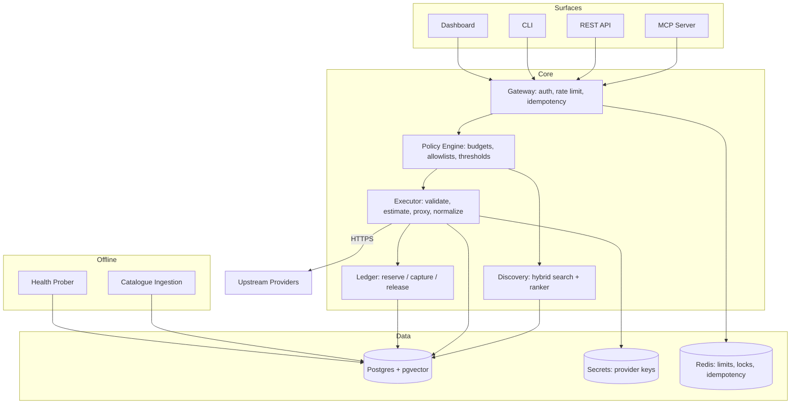

# 04 — Architecture

## Design principles

1. **The ledger is the product.** Everything else is plumbing around a correct
   money-movement engine. If the ledger is wrong, nothing else matters.
2. **Money is integer micro-dollars.** `int64`, never floats, never `NUMERIC` arithmetic
   in application code. 1 micro-dollar = $0.000001.
3. **Never charge for a failure.** Reserve before, capture after, release on error.
4. **Every write is idempotent.** Agents retry. Retries must not double-charge.
5. **Zero payload retention by default.** Store hashes and metadata; store bodies only
   with explicit per-workspace opt-in.
6. **Every decision is explainable.** Ranking returns its own breakdown.

## Component map



## Components

### Gateway
Auth (API key or OAuth), workspace resolution, rate limiting, request-ID assignment,
**idempotency-key handling**. Rejects early and cheaply. No business logic.

### Policy engine
Runs *before* any spend. Evaluates, in order:
1. Is this endpoint allowed for this key? (allow/deny lists)
2. Estimated cost of this call
3. Does it exceed the per-call threshold → require confirmation token
4. Does it fit remaining budget at **session**, **key**, and **workspace** levels
5. Rate limits

Returns `ALLOW`, `DENY(reason)`, or `NEEDS_CONFIRMATION(estimate, token)`.
This component is your primary differentiator. Give it real tests.

### Discovery
Hybrid retrieval, then scoring:

- **Retrieve:** BM25 (Postgres full-text) ∪ vector kNN (pgvector) over endpoint
  name + description + example queries + tags. Union, dedupe, take top ~50.
- **Score:** weighted sum, all sub-scores normalized to 0–1:

```
score = w_fit         * semantic_fit
      + w_price       * price_score        # cheaper = higher
      + w_reliability * success_rate_7d
      + w_latency     * latency_score      # faster = higher
      + w_freshness   * freshness_score
```

Defaults: `w_fit 0.45, w_price 0.25, w_reliability 0.20, w_latency 0.05,
w_freshness 0.05`. **Weights are per-workspace tunable and always returned.**

`price_score` uses the estimated cost *for the caller's actual arguments*, not a list
price — this is what prevents Monid's 26× inversion.

Always return `scoreBreakdown` and always include a `cheapest_viable` marker.

### Executor
The hot path:

1. Load endpoint spec; **validate args against JSON Schema** (reject early, free)
2. Compute cost estimate via the normalized pricing model
3. Ask policy engine → may short-circuit
4. `ledger.reserve(hold_id, estimate_max)`
5. Call upstream with timeout, bounded retries, circuit breaker per provider
6. Normalize response and errors into one envelope
7. Compute **actual** cost from the response (some models bill per result/unit)
8. `ledger.capture(hold_id, actual)` on success, or `ledger.release(hold_id)` on failure
9. Persist run metadata (+ payloads only if opted in)

### Ledger
Append-only double-entry. Three operations, all idempotent by key. See
[05-data-model.md](05-data-model.md) for the invariants and schema. Do not let any other
component write to balances.

### Catalogue ingestion (offline)
Adapters normalize each provider into an internal `ToolSpec`:
OpenAPI/JSON import → normalize → **human review gate** → publish. The review gate is
deliberate: curation is your positioning. Nothing enters the catalogue unverified.

### Health prober (offline)
Runs each endpoint on a schedule with a canned input. Records success/latency into
`health_samples`. Feeds `success_rate_7d` into ranking **and** the public status page.
This is cheap to build and nobody else publishes it.

## Request flows

### `discover`
```
Agent → Gateway (auth, rate limit)
      → Discovery: embed query → BM25 ∪ vector kNN → top 50
      → estimate cost per candidate for these args
      → score + rank → top N
      ← candidates[] with price, health, scoreBreakdown, cheapest_viable flag
```
No money moves. Cache aggressively by (query, workspace, weights).

### `run` — the money path
```
Agent → Gateway (auth, IDEMPOTENCY KEY REQUIRED)
      → validate args against schema        ── fail → 400, no charge
      → estimate cost
      → Policy: budgets, thresholds         ── deny → 402/403, no charge
                                            ── over threshold → 409 + confirmation token
      → Ledger.reserve(hold, estimate_max)  ── insufficient → 402, no charge
      → Upstream call (timeout, retries, breaker)
          ├─ success → compute actual → Ledger.capture(hold, actual)
          └─ failure → Ledger.release(hold)  ── CHARGE ZERO
      → persist run (payloads only if opted in)
      ← normalized envelope + receipt{provider_cost, our_fee, direct_price}
```

The `receipt` object on every response is the transparency lever from
[03-positioning.md](03-positioning.md). Build it into the envelope from day one — it is
almost free at design time and expensive to retrofit.

## Failure semantics

| Situation | Behaviour |
|---|---|
| Invalid args | 400, no hold taken, no charge |
| Insufficient balance | 402 with the shortfall amount |
| Budget exceeded | 402 with which level (session/key/workspace) tripped |
| Over confirmation threshold | 409 + `confirmation_token`, replay with token to proceed |
| Upstream 4xx | Release hold, charge zero, surface provider error verbatim |
| Upstream 5xx / timeout | Retry per policy; if all fail, release hold, charge zero |
| Actual cost > reserved | Capture the reserve, log a variance alert, never exceed the hold |
| Duplicate idempotency key | Return the original result, do not re-execute, do not re-charge |
| Crash between reserve and capture | Reaper releases holds older than TTL (see 05) |

## Deployment shape

Single deployable API process + one worker (health prober, ingestion, hold reaper) +
Postgres + Redis. Do not build microservices. One repo, one binary, one database until
there is a measured reason to split.

Self-host parity is a **product requirement**, not a nice-to-have — the BYOK/open-core
promise in [03-positioning.md](03-positioning.md) depends on `docker compose up` working
for a stranger.
